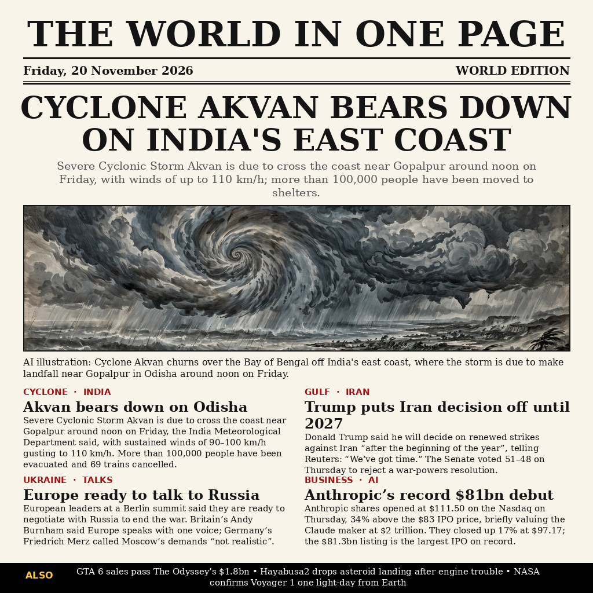

# The World in One Page — 20 November 2026

A one-page newspaper front page summing up Friday, 20 November 2026, in a
single 1024×1024 image — an entry for the
[make.fun news-image-20261120 bounty](https://make.fun/bounty/news-image-20261120).

## What's on the page

- **Main story — Cyclone Akvan bears down on India's east coast.**
  Severe Cyclonic Storm Akvan is due to cross the coast near Gopalpur,
  Odisha, around noon on Friday, with sustained winds of 90–100 km/h
  gusting to 110 km/h. More than 100,000 people have been evacuated and
  69 trains cancelled. (India Meteorological Department; The Hindu;
  The Daily Jagran; Jagran Josh)
- **Gulf · Iran — Trump puts the Iran decision off until 2027.**
  Donald Trump said on Thursday he will decide on renewed strikes
  against Iran "after the beginning of the year". The US Senate voted
  51–48 to reject a war-powers resolution. (Reuters; Fox News; Axios /
  News 12; BusinessWorld)
- **Ukraine · Talks — Europe ready to talk to Russia.**
  European leaders at a Berlin summit said they are ready to negotiate
  with Russia to end the war. (BBC; DW)
- **Business · AI — Anthropic's record $81bn debut.**
  Anthropic shares opened at $111.50 on the Nasdaq, 34% above the $83
  IPO price, briefly valuing the Claude maker at $2 trillion. The
  $81.3 billion listing is the largest IPO on record. (BusinessWorld /
  Reuters; The Hindu BusinessLine; AsiaToday)
- **Also:** GTA 6 sales pass The Odyssey's $1.8bn · Hayabusa2 drops its
  asteroid landing after engine trouble · NASA confirms Voyager 1 is
  one light-day from Earth.

The hero image is an AI illustration of Cyclone Akvan over the Bay of
Bengal, captioned as such on the page. Every story was verified against
at least two trusted outlets before it was written.

## How it works

`main.py` is standard-library only: it copies the finished `entry.png`
(1024×1024, under 1 MiB) to the output directory as `/output/entry.png`
(or `$MAKEFUN_OUTPUT_DIR/entry.png`, or the directory given as the first
argument). No network, no randomness — two runs produce byte-identical
output. The page itself was drawn offline with Pillow at build time
(`compose.py`, not committed) from the AI hero illustration.

## Verification

- `entry.png`: 1024×1024, 586,814 bytes, under the 1 MiB limit.
- Two grader-style runs (`python3 -P -s main.py` into a clean directory)
  produce output byte-identical to the committed `entry.png`.
